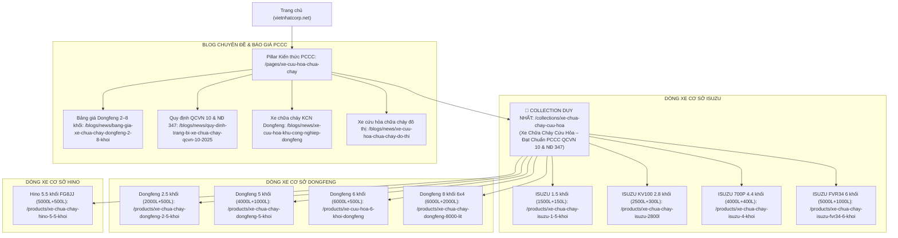

# SKILL & SITEMAP CỤM XE CHỮA CHÁY CỨU HỎA (PCCC) — VIETNHATCORP

Tài liệu chuẩn hóa toàn bộ cấu trúc điều hướng, danh mục sản phẩm, khung pháp lý PCCC mới nhất và quy tắc tối ưu SEO (Slug, Title, Alt ảnh, Internal Link) cho cụm **Xe chữa cháy cứu hỏa** trên `vietnhatcorp.net` (`vietnhatauto.myharavan.com`).

---

## 1. ĐỊNH VỊ THƯƠNG HIỆU & CẤU TRÚC ĐIỀU HƯỚNG

- **Định vị duy nhất:** **XE CHỮA CHÁY CỨU HỎA** (loại bỏ hoàn toàn cách gọi phân tách *"xe chữa cháy lắp ráp"* và *"xe chữa cháy nhập khẩu"* trên Menu, Collection, Title, Blog). Nòng cốt sản phẩm là các dòng xe chuyên dùng đồng bộ trên nền sát-xi **ISUZU Qingling**, **DONGFENG** và **HINO**.
- **Menu Header:** `SẢN PHẨM` -> Cột `CHUYÊN DỤNG` -> `XE CHỮA CHÁY CỨU HỎA` trỏ về `/collections/xe-chua-chay-cuu-hoa`.

---

## 2. KHUNG PHÁP LÝ PCCC MỚI NHẤT & CHIẾN LƯỢC BÁN HÀNG

Khi viết mới hoặc cập nhật nội dung bán hàng, tuyệt đối không dùng các văn bản đã hết hiệu lực (như NĐ 136/2020, NĐ 50/2024) hoặc cam kết chung chung kiểu cũ ("tem kiểm định Cục C07"). Bắt buộc phối hợp 2 văn bản hiện hành theo đúng vai trò chốt sale:

1. **QCVN 10:2025/BCA** (*Quy chuẩn kỹ thuật quốc gia về trang bị, bố trí phương tiện PCCC cho nhà và công trình*):
   - **Vai trò:** Tạo nhu cầu bắt buộc. Dùng để tư vấn chủ đầu tư chọn đúng dung tích xe (1.5 – 8 khối) theo diện tích nhà xưởng, kho bãi, KCN để tránh thiếu định mức khi nghiệm thu.
2. **Nghị định 347/2026/NĐ-CP** (*Ban hành 08/9/2026, hiệu lực từ 15/9/2026 — sửa đổi, bổ sung NĐ 105/2025/NĐ-CP & NĐ 106/2025/NĐ-CP*):
   - **Vai trò:** Đòn bẩy uy tín & xử lý từ chối. Chứng minh hồ sơ của VietNhatCorp hợp chuẩn tuyệt đối theo quy định mới nhất:
     - **Điều 13 (sửa Điều 7 NĐ 105):** Cơ quan đăng kiểm thực hiện **thẩm định thiết kế về PCCC** đối với phương tiện giao thông chuyên dùng.
     - **Điều 21 (sửa Điều 23 NĐ 105):** Bãi bỏ thủ tục cấp Giấy phép lưu thông cũ (Mẫu PC15–PC21); thay bằng **kết quả đánh giá sự phù hợp (hợp quy)** và **kê khai thông tin lưu thông Mẫu PC24** trên hệ thống CSDL PCCC. Phương tiện nhập khẩu đủ điều kiện kê khai được miễn kiểm tra chất lượng hàng hóa khi nhập khẩu.
     - **Điều 16 (sửa Điều 12 NĐ 105):** Chủ phương tiện tổ chức nghiệm thu PCCC phương tiện và thông báo bằng văn bản cho cơ quan chuyên ngành trước khi đưa vào hoạt động.
     - **Điều 20 (sửa Điều 20 NĐ 105):** KCN, cụm công nghiệp có tổng diện tích **từ 75 ha trở lên** bắt buộc bố trí người điều khiển xe chữa cháy trực tại địa điểm bố trí xe.
     - **Điều 32 (sửa Điều 18 NĐ 106):** Cảnh báo rủi ro xử phạt từ **30.000.000 – 50.000.000 đồng** nếu đưa phương tiện vào sử dụng khi chưa hoàn thành tổ chức nghiệm thu PCCC, hoặc phạt **40.000.000 – 50.000.000 đồng** nếu chưa có văn bản thẩm định thiết kế PCCC.

---

## 3. MA TRẬN PHÂN VAI & CHỐNG CANNIBALIZATION

| Tầng / Nhóm | URL Canonical | Phân vai & Intent | Từ khóa sở hữu | CẤM nhắm |
| :--- | :--- | :--- | :--- | :--- |
| **Pillar** | `/pages/xe-cuu-hoa-chua-chay` | Cẩm nang cấu tạo, phân loại 1.5–8 khối, QCVN 10 & NĐ 347 | "xe cứu hỏa", "xe chữa cháy", "quy chuẩn xe chữa cháy" | Giá bán lẻ chi tiết từng model |
| **Collection Duy Nhất** | `/collections/xe-chua-chay-cuu-hoa` | Danh mục thương mại tổng hợp toàn bộ 9 model | "xe chữa cháy cứu hỏa", "xe cứu hỏa", "bán xe chữa cháy" | Phân tách lắp ráp / nhập khẩu |
| **Blog Giá** | `/blogs/news/bang-gia-xe-chua-chay-dongfeng-2-8-khoi` | Bảng giá dự toán trọn gói theo từng phân khúc | "bảng giá xe chữa cháy", "giá xe cứu hỏa dongfeng" | Hướng dẫn vận hành |
| **Blog Quy chuẩn** | `/blogs/news/quy-dinh-trang-bi-xe-chua-chay-qcvn-10-2025` | Pháp lý trang bị, Mẫu PC24, NĐ 347/2026 | "quy định xe chữa cháy KCN", "QCVN 10", "NĐ 347" | Quảng cáo bán hàng lộ liễu |

---

## 4. DANH MỤC 9 SẢN PHẨM CHUẨN HIỆN HỮU

| STT | Slug Sản phẩm (`/products/[slug]`) | Xe cơ sở · Dung tích | Dung tích Bồn Nước / Foam | Bơm & Thiết bị PCCC đồng bộ |
| :-: | :--- | :--- | :--- | :--- |
| **01** | `xe-chua-chay-isuzu-1-5-khoi` | ISUZU QL1070BUHWY (4×2) · 1.5+0.15 khối | 1.500L Nước + 150L Foam | Bơm ly tâm CB10/20 (20 L/s @ 1.0 MPa), lăng phun PL20 phun xa ≥ 45 m |
| **02** | `xe-chua-chay-dongfeng-2-5-khoi` | Dongfeng JDF5073 (4×2) · 2.5 khối | 2.000L Nước + 500L Foam | Bơm CB10/30-XZ (30 L/s), lăng giá nóc PL8/24 tầm phun xa > 50 m |
| **03** | `xe-chua-chay-isuzu-2800l` | ISUZU KV100 (4×2) · 2.8 khối | 2.500L Nước + 300L Foam | Bơm CB10/30 (30 L/s), lăng giá Chengdu Weste PL 8/32 phun xa 60–70 m |
| **04** | `xe-chua-chay-isuzu-4-khoi` | ISUZU 700P / P700 (4×2) · 4.4 khối | 4.000L Nước + 400L Foam | Động cơ 4HK1 (205PS), bơm CB10/30 hoặc CB10/40, PTO Sandwich toàn phần |
| **05** | `xe-chua-chay-dongfeng-5-khoi` | Dongfeng (4×2) · 5.0 khối | 4.000L Nước + 1.000L Foam | Động cơ YCY30 (125kW), bơm CB10/30-RS (30 L/s), lăng giá PL24 |
| **06** | `xe-cuu-hoa-6-khoi-dongfeng` | Dongfeng (4×2) · 6.5 khối | 6.000L Nước + 500L Foam | Động cơ Cummins 169kW (Euro 6), bơm CB10/40 (40 L/s), lăng giá PL8/32 |
| **07** | `xe-chua-chay-hino-5-5-khoi` | Hino FG8JJ (4×2) · 5.5 khối | 5.000L Nước + 500L Foam | Khung gầm Hino 500 series Nhật Bản bền bỉ |
| **08** | `xe-chua-chay-isuzu-fvr34-6-khoi` | ISUZU FVR34 (4×2) · 6.0 khối | 5.000L Nước + 1.000L Foam | Xe tải trung hạng nặng 16 tấn, bồn Inox SUS304, bơm Darley / lăng Shila |
| **09** | `xe-chua-chay-dongfeng-8000-lit` | Dongfeng (6×4) · 8.0 khối | 6.000L Nước + 2.000L Foam | Xe 3 chân hạng nặng, bơm CB10/60 (60 L/s), lăng giá PL48/PL60 |

---

## 5. QUY CHUẨN TỐI ƯU SEO & REDIRECTS (BẮT BUỘC)

1. **Title (Thẻ tiêu đề):** Tuyệt đối không gắn năm `2025`, `2026` vào tiêu đề danh mục hoặc sản phẩm để giữ tính evergreen. Tiêu đề Collection chuẩn: `Xe Chữa Cháy Cứu Hỏa – Báo Giá & Đạt Chuẩn PCCC (QCVN 10 & NĐ 347)`.
2. **Alt ảnh (Media Gallery & Trong bài):** 100% ảnh phải có thuộc tính `alt` mô tả rõ nội dung ảnh, kết hợp tự nhiên cặp từ khóa **"xe cứu hỏa"** và **"xe chữa cháy"** (không nhét số năm `2026`, không để `alt` trống).
3. **Tags sản phẩm:** Bắt buộc chứa 2 tag gốc `xe cứu hỏa`, `xe chữa cháy` kèm hãng xe, dung tích và `PCCC`.
4. **Internal Link:** Mọi liên kết sản phẩm dùng đường dẫn canonical `/products/[slug]` (không lồng `/collections/.../products/...`), mọi liên kết danh mục trỏ về `/collections/xe-chua-chay-cuu-hoa`.
5. **301 Redirects đang hoạt động:**
   - `/collections/xe-chua-chay-nhap-khau` -> `/collections/xe-chua-chay-cuu-hoa`
   - `/collections/xe-cuu-hoa-lap-rap` -> `/collections/xe-chua-chay-cuu-hoa`
   - Các sản phẩm đã xóa (`xe-chua-chay-mini-isuzu-1-khoi`, `xe-chua-chay-ban-tai`, `xe-chua-chay-isuzu-4-2-khoi`) điều hướng về model tương ứng (`xe-chua-chay-isuzu-1-5-khoi`, `xe-chua-chay-isuzu-4-khoi`).
